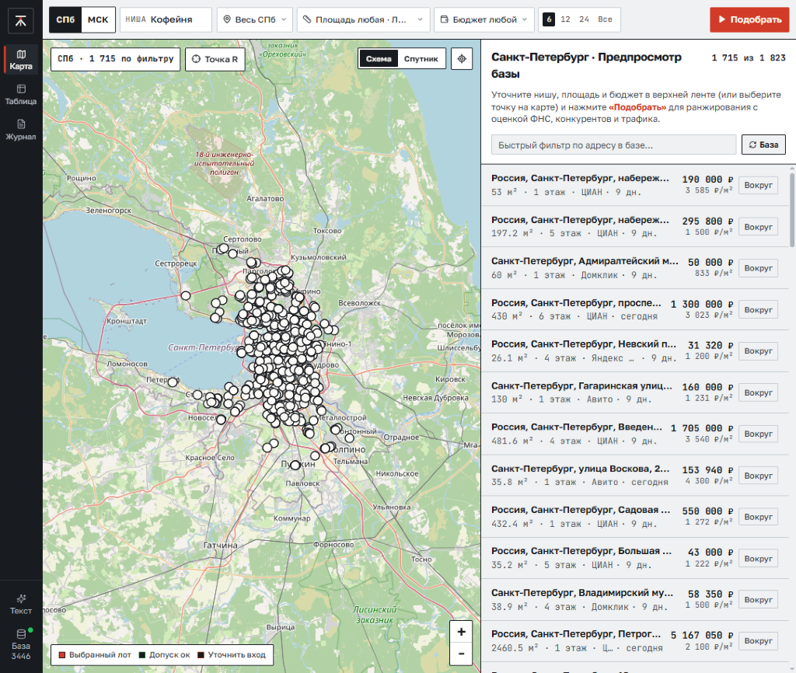
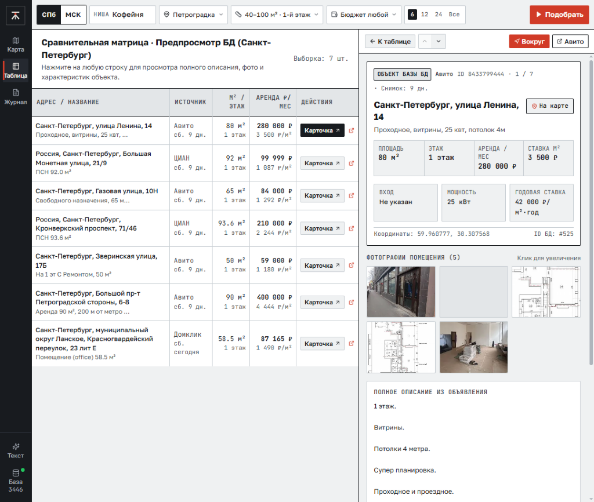

# Reper

**Настольная система пространственной аналитики и подбора коммерческих помещений для открытия офлайн-бизнеса (Санкт-Петербург и Москва).**  
*Desktop spatial analytics workbench & commercial real-estate scoring engine (Python / FastAPI / React + TypeScript / Leaflet / SQLite R-Tree).*





## Возможности

- **Два города и локальные базы SQLite (R-Tree):** отдельные базы Санкт-Петербурга и Москвы, офлайн-справочники районов и кластеров (с защитой уличных запросов от подмены районом), интерактивный выбор точки и радиуса прямо на карте (`Точка R`).
- **Сбор объявлений из 5 источников:** `ЦИАН`, `Авито`, `Яндекс Недвижимость`, `Домклик`, а также муниципальные торги (`ГИС Торги` для СПб и `InvestMoscow` для Москвы) с дедупликацией и отображением ставки `₽/м²` и давности снимка.
- **Доказательный допуск и интервальный скоринг:**
  - проверка этажа, отдельного входа и физических требований концепции без выдумывания отсутствующих фактов (неподтверждённые условия выносятся отдельно);
  - интервальная итоговая оценка (`мин–макс / 100`), прозрачное покрытие факторов и чувствительность рейтинга;
  - предранжирование нецелевых складских/гаражных объявлений ниже торговых помещений для ритейл- и HoReCa-концепций.
- **Анализ окружения в радиусе объекта:**
  - параллельный сбор организаций, жилого населения (OSM / муниципальные справочники), входов и пассажиропотока метро;
  - AI-классификация прямых, косвенных конкурентов и синергии под конкретную бизнес-концепцию (NVIDIA API);
  - опциональное обогащение данных юрлиц по ФНС (через DaData).
- **Настольный и веб-интерфейс:** Windows-оболочка на `PyWebView2`, Canvas-маркеры на `Leaflet`, сравнительная матрица без переполнения, подробное досье объекта с фотографиями и экспорт отчёта в **Markdown** / **JSON**.

## Быстрый старт

### Требования

- Python 3.11+
- Node.js 18+ (для сборки фронтенда)
- Windows 10/11 с WebView2 Runtime (для настольной оболочки `desktop_app.py`; веб-режим `uvicorn` работает кроссплатформенно)

### 1. Установка зависимостей и сборка UI

```powershell
python -m venv .venv
.\.venv\Scripts\Activate.ps1
pip install -r requirements.txt

cd frontend
npm ci
npm run build
cd ..
```

### 2. Запуск

**Настольное приложение (Windows):**
```powershell
python desktop_app.py
```

**Веб-режим (локальный API + собранный SPA):**
```powershell
python -m uvicorn desktop_api:app --host 127.0.0.1 --port 8000
```
После запуска откройте `http://127.0.0.1:8000`.

**Запуск из CLI:**
```powershell
python run_engine.py --help

python run_engine.py --city spb --location "Петроградка" --niche "Кофейня" `
  --min-area 40 --max-area 100 --price 150000 --allowed-floors 1 `
  --concept "Кофейня с собой и выпечкой, обязателен 1-й этаж и удобный вход с улицы."
```

### 3. API-ключи и сбор локальной базы

Ключи не хранятся в репозитории и не требуются для просмотра интерфейса и прогона автотестов:
- Откройте кнопку **«База»** в левом нижнем углу приложения, чтобы указать свой ключ **NVIDIA API** (для AI-классификации и разбора концепции) и опционально **DaData** (для ФНС). На Windows ключи шифруются локально через DPAPI (`.local-secrets/` или `%LOCALAPPDATA%\Reper`).
- Там же можно запустить обновление локальной SQLite-базы объявлений по выбранному городу.

## Тесты

```powershell
python -m unittest discover -s tests -q
```

В проекте `876` модульных, контрактных и регрессионных тестов (логика скоринга, контракты ИИ, этажность/доступ, геофильтры, FastAPI-эндпоинты).

## Сборка дистрибутива Windows

Для сборки автономной папки `dist/Reper/Reper.exe` (PyInstaller) и установщика `dist/Reper_Setup.exe` (Inno Setup 6):

```powershell
pip install pyinstaller
python build_exe.py
```

Доступные флаги: `--skip-frontend`, `--skip-installer`, `--no-seed-db`.

## Структура проекта

| Путь | Назначение |
| --- | --- |
| `real_estate_engine/` | Ядро поиска, парсеры площадок (`collectors/`), окружение, проверка допуска и интервальный скоринг |
| `desktop_api.py` | Локальный FastAPI-сервер (API поиска, предпросмотра карты, фоновых задач, экспорта, секретов) |
| `desktop_app.py` | Настольная оболочка Windows (`PyWebView2`) и точка входа для PyInstaller |
| `run_engine.py` | CLI-интерфейс движка |
| `frontend/` | SPA на React 18, TypeScript, Tailwind CSS, Vite и Leaflet |
| `installer/`, `Reper.spec`, `build_exe.py` | Сборка `.exe` и Windows-установщика (Inno Setup) |
| `data/reference/` | Открытые справочные данные (входы метро и демография) |
| `docs/` | [Архитектура](docs/ARCHITECTURE.md), [бизнес-модель](docs/BUSINESS_MODEL.md), [формула оценки](docs/SCORING_CONCEPT.md), [города и источники](docs/CITIES.md) |
| `tests/` | Автотесты и регрессионные фикстуры |
| `audit/scripts/`, `audit/reports/` | Исследовательские скрипты и сводные отчёты прогонов |
| `CHANGELOG.md` | История архитектурных изменений |

## Отказ от ответственности

Сборщики объявлений работают с публичными веб-страницами площадок, чья структура и антибот-ограничения могут меняться со временем. Проект предоставляется «как есть» (as-is) в рамках лицензии MIT.

## Лицензия

[MIT](LICENSE)
